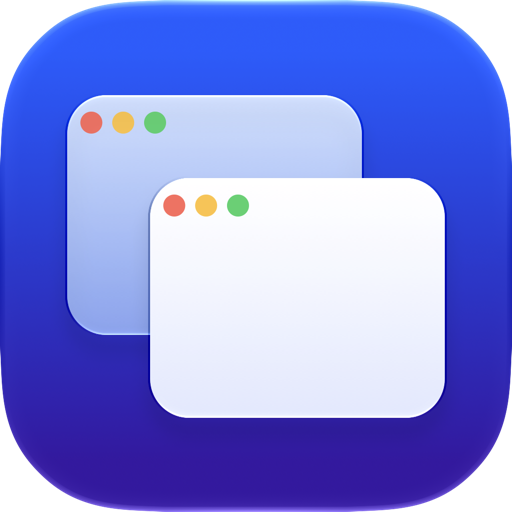
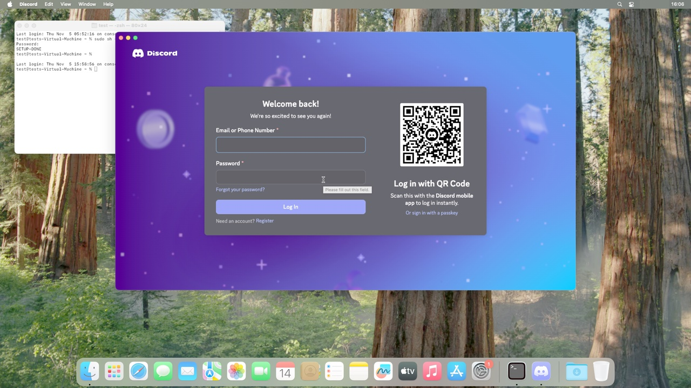
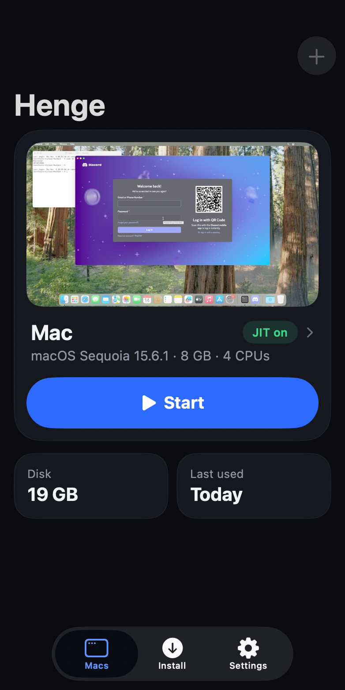
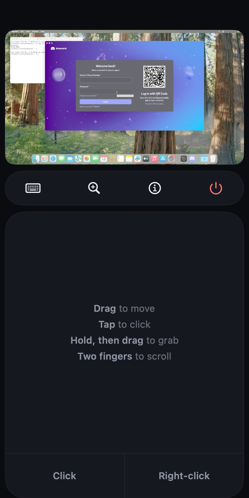
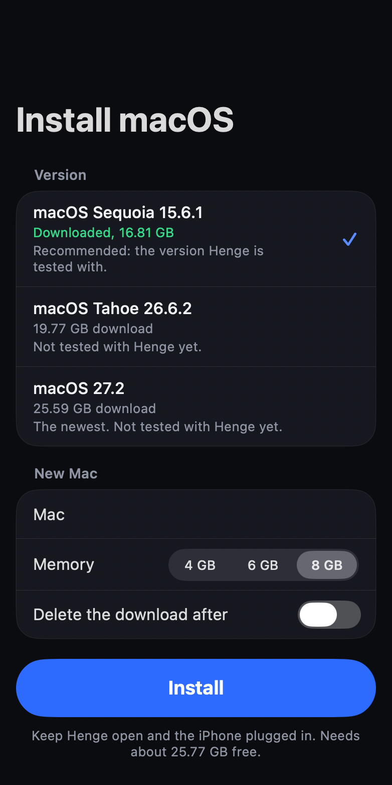

<p align="center">
  
</p>

<h1 align="center">Henge</h1>

<p align="center">macOS on your iPhone.</p>

<p align="center">
  <a href="#install">Install</a>
  ·
  <a href="docs/architecture.md">How it works</a>
  ·
  <a href="https://itslevii.dev">Website</a>
  ·
  <a href="https://github.com/Leviidev/Henge/releases">Releases</a>
</p>

<p align="center">
  <a href="https://github.com/Leviidev/Henge/releases"></a>
  <a href="LICENSE"></a>
</p>

Download macOS, install it on the iPhone, and use it.

- **Own emulator** — iOS gives apps no hypervisor, so Henge runs the Mac's arm64 code through its own JIT, with its own MMU and devices. It doesn't use QEMU or Virtualization.framework.
- **Installs on the iPhone** — Henge downloads Apple's restore image and restores it the way a Mac does. No Mac needed, and nothing is decrypted or patched.
- **Graphics** — macOS draws through a virtual GPU, and Henge replays its commands with Metal. Safari and Electron apps like Discord draw on it.
- **Touch** — The screen is a trackpad: hold to drag, two fingers to scroll. Esc, Tab, Control, Option and Command sit above the keyboard.

On an iPhone 17 Pro, macOS reaches the lock screen in about 15 seconds. Discord installs, opens in about 15 seconds, logs in and sends messages.

## Install

Sideload `Henge.ipa` from [Releases](https://github.com/Leviidev/Henge/releases) with SideStore or AltStore, or install `Henge.tipa` with TrollStore. iOS 17 or later, and so far tested only on an iPhone 17 Pro.

- **JIT** is required: StikDebug, TrollStore, a jailbreak, or the StikJIT helper built into Henge (iOS 26 or later).
- **Storage:** about 43 GB free for macOS Sequoia. That's 17 GB for the download, which you can delete afterwards, and 26 GB for the Mac.
- **Memory:** a Mac gets 4, 6 or 8 GB. Sign Henge with the increased memory limit entitlement if your certificate has it.

Then open the Install tab, pick macOS Sequoia 15.6.1, and keep Henge open with the iPhone plugged in. Tahoe 26.6.2 and macOS 27.2 are offered too, but they aren't tested yet.

## Known limits

- Signing in to an Apple Account inside macOS fails with a verification error.
- Some GPU commands aren't implemented yet, so some apps may draw wrongly.
- Only one Mac can start per launch. Quit Henge and open it again to start another.
- It's emulation, so it runs slower than a real Mac.

## Screenshots

<table>
  <tr>
    <td align="center" colspan="3"><br><sub>Discord</sub></td>
  </tr>
  <tr>
    <td align="center" width="33%"><br><sub>Macs</sub></td>
    <td align="center" width="33%"><br><sub>Trackpad</sub></td>
    <td align="center" width="33%"><br><sub>Install macOS</sub></td>
  </tr>
</table>

<sub>Captured on a Mac: Discord is a frame from Henge's renderer, and the others are the app's own screens with sample data.</sub>

## Building

On a Mac with Xcode and `xcodegen`. Henge takes StikJIT, on-device pairing, libslirp and glib from a built [Husk](https://github.com/Leviidev/Husk) checkout at `~/Documents/Coding/Husk` (set `HUSK` to use another path):

```bash
ios/scripts/fetch_deps.sh
tools/build_ios_restore.sh
make ios-lib
ios/scripts/package_ipa.sh
```

That produces `~/Desktop/Henge.ipa`, and `package_ipa.sh --trollstore` writes `Henge.tipa`. The build copies Apple's boot ROM (`AVPBooter.vmapple2.bin`) from the Mac's Virtualization framework into the app.

`make` builds the engine for the Mac, `build/hengevm`, and `make test` runs its tests.

## Licence

GPL-2.0-or-later. Henge compiles in usbmuxd (GPLv2 or GPLv3) and code from Husk (GPL-2.0-or-later), so the shipped binary is a combined GPL work. It cannot go on the App Store. See [docs/licensing.md](docs/licensing.md).

macOS and the boot ROM are Apple's and aren't covered by this licence.
